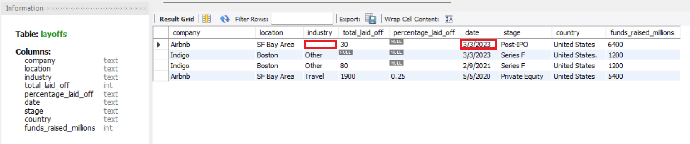
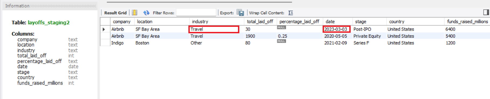

# Layoffs Data Cleaning (MySQL)

A SQL data cleaning project on a real-world dataset of global company layoffs. The goal was to turn a messy raw table into a clean, analysis-ready one using MySQL.

## Dataset

- **File:** `layoffs.csv` (about 2,300 rows)
- **Columns:** company, location, industry, total_laid_off, percentage_laid_off, date, stage, country, funds_raised_millions

## Tools

- MySQL 8.0
- MySQL Workbench

## Approach

### 1. Protect the raw data
The original `layoffs` table is never modified. I created `layoffs_staging` as a copy and did the cleaning on a second copy, `layoffs_staging2`.

### 2. Remove duplicates
The table has no unique ID, so I used `ROW_NUMBER()` with `PARTITION BY` across every column inside a CTE. Rows with a row number above 1 are duplicates. I checked several companies by hand (Casper, Cazoo, Hibob, Wildlife Studios, Yahoo) before deleting.

### 3. Standardize the data
- Trimmed extra spaces in the text columns
- Merged "Crypto" and "Crypto Currency" into a single "Crypto" category
- Fixed "United States." (trailing period) with `TRIM(TRAILING '.' FROM country)`, because a plain `TRIM()` did not remove it
- Converted `date` from text to a real `DATE` type using `STR_TO_DATE()` and `ALTER TABLE`

### 4. Handle nulls and blanks
- Converted blank industry values to `NULL`
- Used a self join to fill missing industries from other rows of the same company (for example, Airbnb's blank industry became "Travel")
- Left Bally's Interactive as `NULL` because it appears only once and there is nothing reliable to fill it with

### 5. Remove unusable rows and columns
- Deleted rows where both `total_laid_off` and `percentage_laid_off` are `NULL`, since they carry no information for analysis
- Dropped the helper `row_num` column

## Before and after

| Before | After |
|--------|-------|
|  |  |

What changed: dates went from text (`3/3/2023`) to `DATE` (`2023-03-03`), Airbnb's blank industry was filled with "Travel", and the empty Indigo row was removed.

## How to run

1. Create a database: `CREATE DATABASE world_layoffs;`
2. Import `layoffs.csv` into a table named `layoffs` (MySQL Workbench: Table Data Import Wizard)
3. Run `Data_Cleaning.sql` from top to bottom
4. The cleaned data is in `layoffs_staging2`

## Possible improvements

- Convert `percentage_laid_off` from text to a numeric type
- Standardize `location` and `stage` further if needed for analysis

## Next step

Exploratory data analysis on the cleaned table to find trends in layoffs by industry, country, company stage and date.

## Author

Hasan Javed
